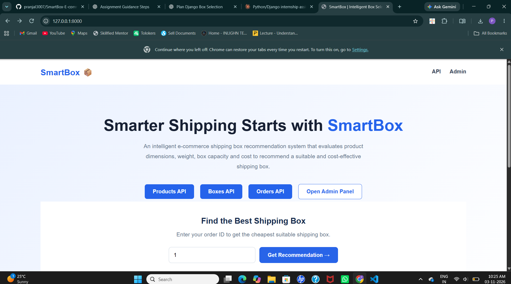
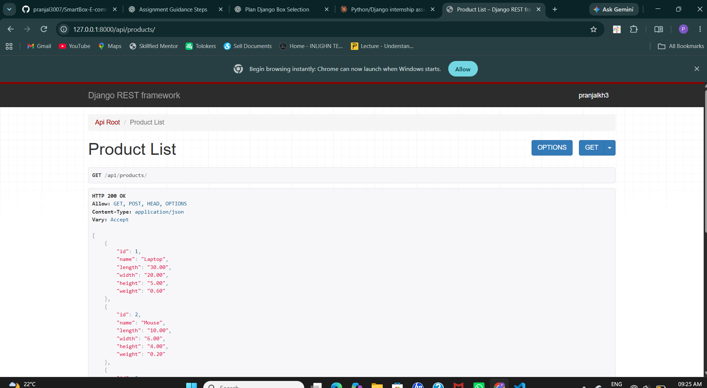
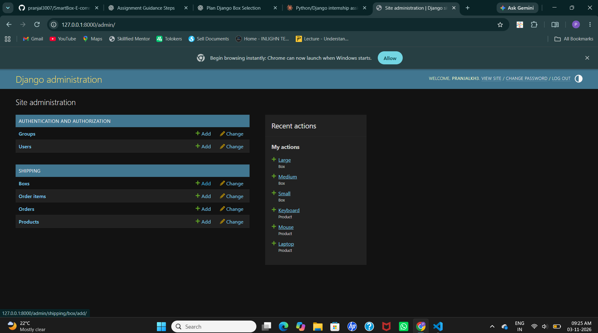
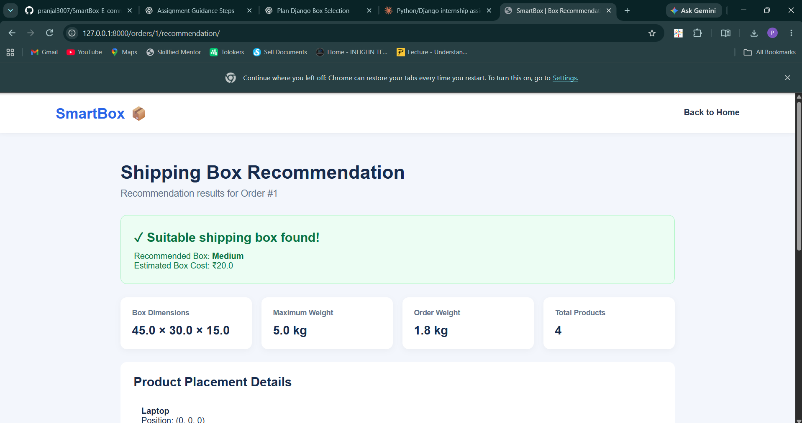
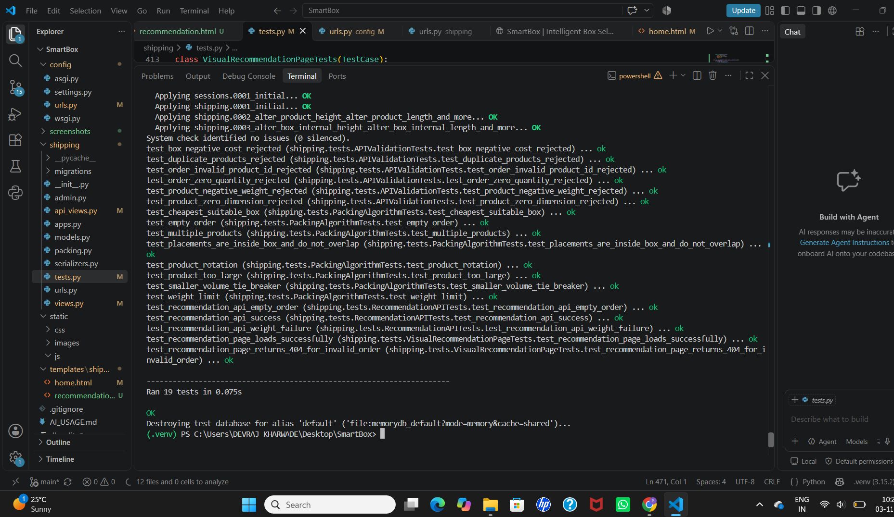

# SmartBox – E-commerce Shipping Box Recommendation System

## 1. Project Overview

SmartBox is an AI-assisted shipping box recommendation system designed to select a suitable and cost-effective shipping box for e-commerce orders.

The system evaluates product dimensions, product weight, available box dimensions, maximum weight capacity, and box cost. It uses a 3D packing heuristic to check whether all products can fit inside a single box, allowing product rotation.

The system recommends the cheapest suitable box. If multiple suitable boxes have the same cost, it selects the box with the smaller volume.

## 2. Features

- Product management through REST APIs.
- Shipping box management through REST APIs.
- Order creation with multiple products and quantities.
- Product rotation during 3D packing.
- Multiple products packed into a single box.
- Product overlap detection.
- Box weight-capacity validation.
- Cheapest suitable box recommendation.
- Smaller-volume tie-breaker for equal-cost boxes.
- Visual recommendation dashboard.
- Homepage form to enter an Order ID and view recommendations.
- Django Admin interface.
- Automated test suite with 19 tests.

## 3. Technology Stack

| Technology | Purpose |
|---|---|
| Python | Core programming language |
| Django | Backend framework |
| Django REST Framework | REST API development |
| SQLite | Database |
| HTML and CSS | Homepage and recommendation dashboard |
| Django Admin | Data management |
| DRF Browsable API | API testing |

## 4. Project Structure

```text
SmartBox-Submission/
├── config/
│   ├── __init__.py
│   ├── settings.py
│   ├── urls.py
│   ├── asgi.py
│   └── wsgi.py
├── shipping/
│   ├── migrations/
│   ├── __init__.py
│   ├── admin.py
│   ├── api_views.py
│   ├── apps.py
│   ├── models.py
│   ├── packing.py
│   ├── serializers.py
│   ├── tests.py
│   ├── urls.py
│   └── views.py
├── templates/
│   └── shipping/
│       ├── home.html
│       └── recommendation.html
├── static/
├── screenshots/
├── manage.py
├── requirements.txt
├── README.md
├── AI_USAGE.md
├── CHAT_TRANSCRIPT.md
├── TEST_CASES.md
├── TEST_OUTPUT.md
├── WHAT_I_LEARNED.md
├── GitHub_Link.txt
└── .gitignore
```

## 5. Installation and Setup

### Prerequisites

- Python installed
- pip package manager
- Git

### Step 1: Clone the repository

```bash
git clone https://github.com/pranjal3007/SmartBox-E-commerce-Shipping-Box-Recommendation-System.git
cd SmartBox-E-commerce-Shipping-Box-Recommendation-System
```

### Step 2: Create a virtual environment

```bash
python -m venv .venv
```

Activate it on Windows:

```powershell
.venv\Scripts\Activate
```

### Step 3: Install dependencies

```bash
pip install -r requirements.txt
```

### Step 4: Apply database migrations

```bash
python manage.py migrate
```

### Step 5: Create an admin account

```bash
python manage.py createsuperuser
```

### Step 6: Start the development server

```bash
python manage.py runserver
```

Open these URLs:

- Homepage: http://127.0.0.1:8000/
- API Root: http://127.0.0.1:8000/api/
- Admin Panel: http://127.0.0.1:8000/admin/

## 6. API Endpoints

| Method | Endpoint | Description |
|---|---|---|
| GET | `/api/products/` | List products |
| POST | `/api/products/` | Create a product |
| GET | `/api/products/{id}/` | Retrieve a product |
| PATCH | `/api/products/{id}/` | Update a product |
| DELETE | `/api/products/{id}/` | Delete a product |
| GET | `/api/boxes/` | List shipping boxes |
| POST | `/api/boxes/` | Create a shipping box |
| GET | `/api/boxes/{id}/` | Retrieve a shipping box |
| PATCH | `/api/boxes/{id}/` | Update a shipping box |
| DELETE | `/api/boxes/{id}/` | Delete a shipping box |
| GET | `/api/orders/` | List orders |
| POST | `/api/orders/` | Create an order |
| GET | `/api/orders/{id}/` | Retrieve an order |
| PATCH | `/api/orders/{id}/` | Update an order |
| DELETE | `/api/orders/{id}/` | Delete an order |
| GET | `/api/orders/{id}/recommend-box/` | Generate a box recommendation |

## 7. Homepage and Recommendation Workflow

SmartBox provides a homepage where users can enter an existing Order ID to generate a shipping box recommendation.

### Workflow

1. Open the SmartBox homepage.
2. Enter an existing Order ID.
3. Click **Get Recommendation**.
4. The system retrieves the order and its products.
5. The packing algorithm evaluates available shipping boxes.
6. The recommendation dashboard displays the selected box, cost, dimensions, order weight, and product placements.

### Visual Recommendation Page

The visual recommendation page is available at:

`/orders/<order_id>/recommendation/`

The homepage uses the recommendation lookup form to navigate to this page.

## 8. Box Recommendation Algorithm

The recommendation process follows these steps:

1. Retrieve all products and quantities from an order.
2. Calculate the total order weight.
3. Expand product quantities into individual packing items.
4. Sort available boxes by cost, then by volume.
5. Reject boxes that cannot support the total order weight.
6. Sort products by volume in descending order.
7. Generate possible product orientations using dimension permutations.
8. Find candidate placement coordinates based on existing item edges.
9. Check box boundaries and product overlap.
10. Return the first suitable box found in the cost-sorted order.

The algorithm allows rotation and attempts to pack the complete order into one box.

## 9. Business Rules and Assumptions

- All products must fit into one shipping box.
- Orders cannot be split across multiple boxes.
- Product rotation is allowed.
- Multiple products can share one box.
- Product dimensions must be greater than zero.
- Product weight must be greater than zero.
- Box maximum weight cannot be negative.
- Box cost cannot be negative.
- Order quantities must be at least one.
- Duplicate products in an order are rejected; quantities should be increased instead.
- Packaging padding is ignored.
- The recommended box is selected based on the lowest cost, with smaller volume used as a tie-breaker.

## 10. Algorithm Limitations

The packing implementation uses a heuristic approach rather than an exhaustive 3D bin-packing solver.

It checks candidate positions and product orientations but does not guarantee that every possible valid arrangement will be discovered.

Therefore, a failed packing attempt does not necessarily prove that no physically valid arrangement exists.

## 11. Automated Testing

Run the automated tests using:

```bash
python manage.py check
python manage.py test shipping -v 2
```

The current test suite contains 19 tests covering:

- Product and box validation
- Order validation
- Product rotation
- Multiple-product packing
- Weight constraints
- Box cost selection
- Volume tie-breaking
- Placement boundaries and overlap
- Recommendation API success and failure responses
- Visual recommendation page rendering
- Invalid order handling (404)

**Latest verified test result: 19 tests passed.**

See `TEST_OUTPUT.md` for the recorded test execution output.

## 12. Project Screenshots

### SmartBox Homepage



### Products API



### Django Admin Panel



### Shipping Box Recommendation Dashboard



### Automated Test Results



## 13. Future Improvements

- More advanced 3D packing algorithms.
- Packaging padding and product protection constraints.
- User authentication and role-based permissions.
- Interactive 3D visualization of product placement.
- Improved frontend experience.
- Deployment to a cloud platform.
